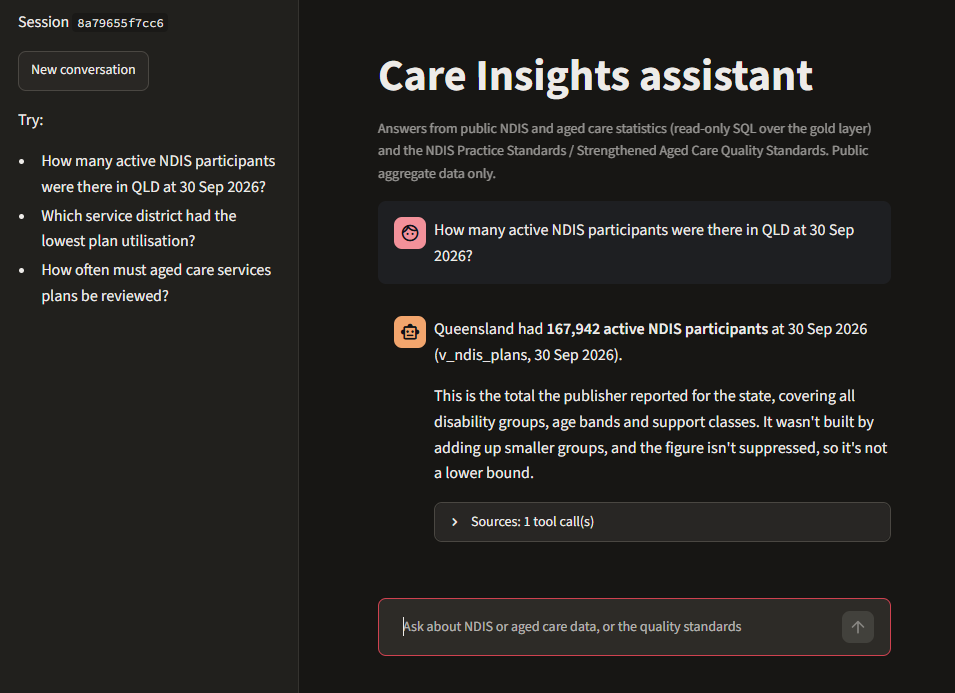

# Care Insights Platform

A data platform and AI assistant for a care provider (disability/NDIS and aged home care), built end to
end on **public data** in my own Azure tenant and Microsoft Fabric capacity.

> Personal portfolio project. Not affiliated with any provider. Public data only: no client data, code or tenants.

## The problem

A care provider's data team has to answer three kinds of question, safely:

1. **Managers need regional figures.** How many participants are there in my region, what do their plans
   cost, and how much of each budget is used? A state manager should see their state, not everyone's.
2. **Staff need answers in plain English**, from governed data and the quality standards, with sources they can
   check. The tool must not invent numbers, expose individuals, or change data.
3. **IT needs all of it to be repeatable and auditable**: tested data, least-privilege identities, no secrets
   lying around, and every change deployed through CI.

This project builds that on public NDIS and aged care data:

- a governed **Fabric lakehouse**;
- a **Power BI** model and report with **row-level security by state**;
- a **Claude assistant** that reads approved views and cites the standards, **containerised on Azure** and
  deployed by **GitHub Actions**.

## What's built

| Part | Status and evidence |
|---|---|
| Public data sources and download script | Done: 9 sources, sizes and SHA-256 in a manifest |
| Bronze → silver → gold lakehouse | Done: **60/60** automated data tests |
| Power BI: Direct Lake model, 6 DAX measures, 2 report pages | Done: model = SQL row counts; **18/18** measure tests against independent SQL |
| Row-level security by state | Done: **19/19** tests, running DAX as test users |
| Claude assistant: governed SQL tool + policy search with page citations | Done: **20/20** on the eval set |
| Docker → Azure Container Apps (scale to zero, managed identity) | Done |
| GitHub Actions CI/CD (tests, image build, deploy via OIDC) | Done: every merge to `main` deploys itself |
| [Governance](docs/governance.md) and [architecture](docs/architecture.md) | Done |
| Demo video | In progress |

## Architecture

In short (diagrams with the identity on every arrow: [docs/architecture.md](docs/architecture.md)):

```text
Public sources ──► OneLake ──► bronze ──► silver ──► gold (star schema, tested)
                                                      │
                     ┌────────────────────────────────┴───────────────────────────┐
                     ▼                                                            ▼
     Semantic model (Direct Lake, RLS by state)              SQL endpoint: 7 read-only views
     read as an identity limited to gold                     read by the app's managed identity
                     ▼                                                            ▼
           Power BI report                                  Assistant on Azure Container Apps ──► Claude API
                                                            (access code, logs to Log Analytics)

GitHub PR ──► test + build (required) ──► merge ──► image to GHCR (SHA tag) ──► OIDC deploy to Container Apps
```

## The assistant



Ask in plain English, and get an answer with its source:

- **Explore NDIS statistics**: active participants, average plan budgets, plan utilisation and provider numbers
  by state and service district (Sep 2025 and Sep 2026), broken down by disability group, age band or support class,
  plus participants by SA3 every quarter since 2019.
- **Explore aged care at home**: people in Home Care Packages (by level) and people served by the Commonwealth
  Home Support Programme, by LGA, SA3, planning region or PHN.
- **Compare and track change**: year-on-year change and % growth, highest and lowest regions, one region against another.
- **Ask about the quality standards**: what the NDIS Practice Standards and the Strengthened Aged Care Quality
  Standards require, with the document and page cited.
- **Check every answer**: expand **Sources** to see the exact SQL that ran and the rows it returned, or the
  policy passages found.

It **won't**:

- identify or speculate about individual people or providers;
- give clinical, legal or funding advice;
- answer beyond its data;
- change any data.

Hidden small counts are reported as "fewer than N", never guessed. The full guide with example questions is
[docs/user-guide.md](docs/user-guide.md).

**Hosted demo:** on Azure Container Apps behind an access code. URL and code on request.

## Power BI

- **Semantic model `sm_care_insights`**: Direct Lake on OneLake over the gold star schema, written as **TMDL in
  the repo** and deployed by script.
- **Measures that can't double-count.** The facts hold both the publisher's subtotals and the detail rows. Every
  measure reads **the one published cell** for the current slice:
  - when nothing is filtered, it reads the subtotal ("ALL") row;
  - region: the coarsest level in view (national, then state, then district);
  - date: the latest period in view;
  - averages, rates and provider counts: blank rather than re-weighted.

  Implicit measures are off and raw value columns are hidden, so a visual can't sum them by accident.
- **Row-level security**: one dynamic role. A user sees only the states mapped to them in a gold table.
  - No mapping means no data.
  - State users never see national rows.
  - Users have Read on the model and no workspace role, so there's no route around RLS.
- **Report `rpt_care_insights`** (written as PBIR in the repo) has two pages:
  - **NDIS overview:** cards, participants by state, and a table of service districts that the state bar filters.
  - **Aged care at home:** home care (HCP) and home support (CHSP) shown side by side and **never added
    together**: HCP counts people in a package on 30 June, CHSP counts people served during the year.

## Deployment

- **Image**: `python:3.12-slim-bookworm` with ODBC Driver 18, a non-root user and the policy index. The Docker
  build context is an **allow-list**, so `.env` and other secrets can't get in.
- **Azure Container Apps**:
  - scales to zero, with at most 1 replica (each Streamlit conversation lives in memory);
  - signs in to SQL with a **managed identity**, so there's no SQL secret anywhere;
  - logs go to Log Analytics, kept for 30 days.
- **GitHub Actions**:
  - **test** and **build** run on every PR and are required to merge.
  - A merge to `main` builds the image, pushes it to GHCR **tagged with the commit SHA**, deploys it over
    **OIDC** (no Azure secret in GitHub) and smoke-tests the new revision.

## Data

| Source | Publisher | Grain |
|---|---|---|
| NDIS participants, plan budgets, utilisation, active providers | NDIA | quarter × state × service district × cohort |
| NDIS participants by SA3 | NDIA | quarter × SA3 |
| People using home care (HCP) and home support (CHSP) | AIHW GEN | period × region |
| NDIS Practice Standards v4; Strengthened Aged Care Quality Standards (Nov 2025) | NDIS Commission; Dept of Health | PDFs for retrieval |

Statistics are CC BY 4.0. The standards are Commonwealth publications whose licences are to be confirmed. Licences,
refresh dates and quirks are in [docs/data-sources.md](docs/data-sources.md).

## Key design decisions and trade-offs

Full reasoning, including the options I rejected, is in:

- [docs/data-dictionary.md](docs/data-dictionary.md): the lakehouse;
- [docs/assistant.md](docs/assistant.md): the assistant;
- [docs/governance.md](docs/governance.md): the controls.

### Lakehouse

- **Suppressed cells stay NULL with a flag and an upper bound**, never imputed. With bounds as wide as 45,029,
  any imputed number would be invented, and then summed into totals that look exact.
- **Publisher subtotals are kept, and measures read the published cell** rather than summing the parts. Summing
  the detail undercounts by about 10%, because suppressed cells count as nothing.
- **One `dim_region` keyed by region type × code**, with `state_code` on every row as the row-level security key.
- **Aged care programs are never added together**: HCP is a stock and CHSP is a flow, so there's deliberately no
  "total recipients" measure.

### Semantic model and RLS

- **Direct Lake on OneLake rather than on the SQL endpoint.** It never falls back to DirectQuery, and doesn't
  depend on the endpoint's metadata lag or its permissions.
- **A fixed identity reads OneLake, not each viewer.** If viewers needed lakehouse access, they could read around
  RLS. The model's identity can read `kanda_gold` only.
- **Aged care state totals use SA3, not PHN.** Primary Health Networks cross state borders, so state totals by PHN
  are off by up to about 760 people. SA3 matches LGA in every state.
- **Trade-off:** dynamic RLS needs a mapping table and one manual step: the service drops role members from a
  deployed definition, so the group is added once in the browser. In return there's one role, and access changes
  are data changes.

### Assistant and governance

- **The database is the security boundary.** The reader identities are workspace Viewers with `GRANT SELECT` on
  the assistant views only and `DENY` on the tables. `scripts/setup_assistant_sql.py` proves this on every run:
  all 7 views readable, all tables denied, DDL denied.
- **App-side SQL guard** (sqlglot):
  - exactly one SELECT, on allow-listed views only;
  - no DML, DDL, EXEC or `SELECT INTO`;
  - a 200-row cap and a 30-second timeout.

  It's covered by 24 unit tests, and it returns precise errors that Claude can correct.
- **Hybrid retrieval without a vector database**: local embeddings (bge-small) plus BM25, merged with reciprocal
  rank fusion. The 217 chunks follow page boundaries, so every answer cites one PDF page.
- **Questions are logged in full for 30 days**, so answers can be audited. The chat page tells users before they type.

### Delivery

- **No long-lived secrets in the delivery path**: OIDC from GitHub to Azure, and a managed identity from the app
  to SQL. The deploy identity can update only the app and its environment, not the resource group that holds the
  Fabric capacity.
- **The policy index is committed rather than built in CI**, because the government sites stall downloads from
  CI runners. **Trade-off:** derived data in Git. It's rebuilt locally when a PDF changes.
- **Not yet in CI:** the semantic model and report are code in the repo and deployed by scripts, but from a
  workstation.

## Evaluation and tests

| What | How | Latest |
|---|---|---|
| Lakehouse | `gold_tests.py`: unique and not-null keys, foreign keys, row counts bronze → gold, published anchors | 60/60 |
| Semantic model | `deploy_semantic_model.py`: every table's row count equals the SQL endpoint | all match |
| DAX measures | `test_measures.py`: 18 cases, each DAX result compared with independent SQL over gold | 18/18 |
| Row-level security | `test_rls.py`: DAX run as each test user (impersonation) | 19/19 |
| SQL guard | `pytest tests`: allowed and rejected queries, row cap | 24/24 |
| Assistant | [eval/questions.yaml](eval/questions.yaml): 13 data, 4 policy and 3 scope questions (personal data, out of coverage, prompt injection), graded deterministically | 20/20, US$0.70 per run ([results](eval/results/latest.md)) |

## How to run

```bash
python -m venv .venv && .venv/bin/pip install -r requirements.txt
cp .env.example .env                      # fill in; .env is git-ignored

# Lakehouse
scripts/download_data.sh                  # public sources → data/raw/
.venv/bin/python scripts/upload_raw.py    # → OneLake
for nb in bronze_load silver_transform gold_build gold_tests; do
  .venv/bin/python scripts/fabric_notebook.py deploy-run fabric/notebooks/$nb.py
done

# Power BI
.venv/bin/python scripts/setup_rls.py                 # group, test users, mapping upload
.venv/bin/python scripts/fabric_notebook.py deploy-run fabric/notebooks/security_load.py
.venv/bin/python scripts/deploy_semantic_model.py     # TMDL → model, reframe, row-count check
.venv/bin/python scripts/test_measures.py && .venv/bin/python scripts/test_rls.py
.venv/bin/python scripts/deploy_report.py deploy      # PBIR → report

# Assistant
.venv/bin/python scripts/setup_assistant_sql.py       # views, grants, proof of access
.venv/bin/streamlit run assistant/app.py              # chat page (index in data/index/)
.venv/bin/python -m pytest tests                      # SQL guard tests (no cloud needed)
.venv/bin/python eval/run_eval.py                     # 20-question eval

# Container
docker build -t care-insights:local .
docker run --rm -p 8501:8501 --env-file .env care-insights:local
```

You'll need:

- a Fabric capacity (F2 here);
- the Microsoft ODBC Driver 18 for SQL Server;
- an Anthropic API key;
- service principals for the reader and model identities.

Azure Container Apps and OIDC setup is in the deploy workflow ([.github/workflows/ci.yml](.github/workflows/ci.yml)).

## Cost

Total budget is about A$50, with an Azure budget alert at A$30.
- **Fabric F2 capacity:** the main cost. It's paused between sessions.
- **Container Apps:** scales to zero when nobody is using it.
- **Log Analytics:** a few MB of logs, kept for 30 days.
- **Anthropic API:** the key is prepaid with a hard spend limit. One eval run costs about US$0.70.

## Repository

| Path | What |
|---|---|
| `fabric/notebooks/` | Bronze, silver, gold, test and RLS-mapping notebooks (`.py` is the source, deployed by script) |
| `fabric/semantic_model/` | Semantic model as TMDL: tables, relationships, measures, RLS role |
| `fabric/reports/` | Power BI report as PBIR |
| `fabric/sql/` | Assistant views |
| `assistant/` | Agent loop, SQL tool and guard, policy search, Streamlit app |
| `data/index/` | Policy search index (committed; rebuilt with `python -m assistant.policy_search build`) |
| `eval/` | Questions, runner, latest results |
| `scripts/` | Download, upload, Fabric API client, notebook / model / report deploy, SQL access and RLS setup, tests |
| `tests/` | SQL guard unit tests |
| `config/` | Example RLS mapping (the real one is git-ignored) |
| `Dockerfile`, `.github/workflows/` | Container image and CI/CD |
| `docs/` | Architecture, governance, user guide, data sources, data dictionary, assistant design |
