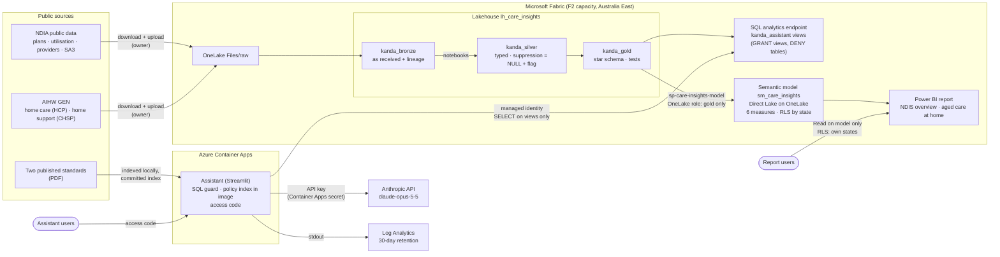
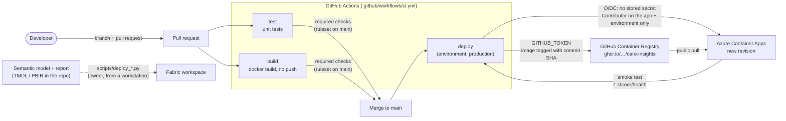

# Architecture

The platform has two diagrams: how data flows and who can reach it, then how code reaches production.
Every arrow is labelled with the **identity** it uses. The controls behind each identity are in
[governance.md](governance.md#2-access-model).

## 1. Data and access

Reading the diagram:

- **Two consumers, two read paths.** The report reads gold through the semantic model, as an identity that can
  read only `Tables/kanda_gold`. The assistant reads through seven views on the SQL endpoint, as an identity the
  database lets run SELECT on those views and nothing else. Neither path can write.
- **Row-level security sits in the model.** Report users have Read on the model and no workspace role, so they
  can't reach the lakehouse or the SQL endpoint around it.
- **No secrets on the Azure side for data access.** The app signs in to SQL with its managed identity. The only
  secrets in Azure are the Anthropic key and the access code.
- **What leaves the platform:** only questions, tool results (public aggregates) and policy excerpts go to the
  Anthropic API.

## 2. Delivery (CI/CD)

- **Nothing reaches `main` without passing CI.** The ruleset requires a PR whose **test** and **build** checks
  are green, and it blocks force pushes.
- **Every running revision traces to a commit.** Images are tagged with the commit SHA, never `latest`.
- **No Azure secret in GitHub.** Azure trusts only jobs in this repo's `production` environment, and that trust
  is pinned to GitHub's immutable owner and repo IDs.
- **The Fabric side isn't in CI yet.** The semantic model and report are code in the repo (TMDL and PBIR),
  deployed and tested by scripts, but run from a workstation. Running those scripts in CI would need a Fabric
  deploy identity; that's the next step for a production setup.
