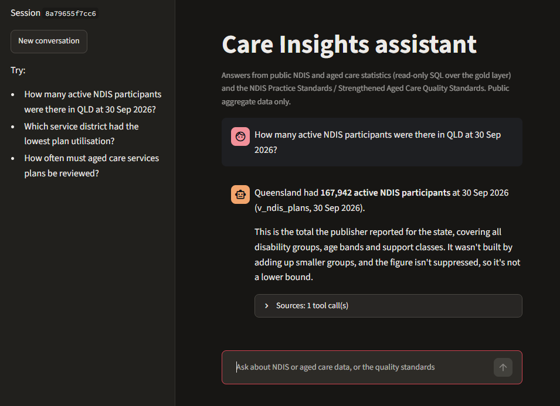

# User guide: Care Insights assistant

The assistant answers questions about public NDIS and aged care statistics, and about two quality
standards documents. Ask in plain English. Every number comes from a read-only SQL query, every policy
point comes from the documents, and every answer says where it came from.



## Starting the app

```bash
.venv/bin/streamlit run assistant/app.py      # then open http://localhost:8501
```

The Fabric capacity must be running for data questions (policy questions work without it).
Setup is in the [README](../README.md#how-to-run).

## The screen

| Area | What it does |
|---|---|
| **Chat box** (bottom) | Type a question and press Enter. Answers take about 10–20 seconds |
| **Answer** | The answer first, then the supporting figures. Every figure has a citation, e.g. `(v_ndis_plans, 30 Sep 2026)` |
| **Sources: N tool call(s)** | Click to expand it. For data questions it shows the exact SQL that ran and the rows it returned. For policy questions it shows the passages found, with document and page |
| **Sidebar: New conversation** | Starts a new conversation. The assistant remembers earlier questions within a conversation, so follow-ups such as "and for NSW?" work |
| **Sidebar: Try** | Example questions to start with |

## What you can ask

### NDIS statistics (NDIA, public)

| Data | Periods | Levels | Breakdowns |
|---|---|---|---|
| Active participants and average annualised plan budget | 30 Sep 2025, 30 Sep 2026 | National, state, service district | Disability group, age band, support class |
| Plan utilisation (share of committed budget used) | 30 Sep 2025, 30 Sep 2026 | National, state, service district | As above, plus SIL/SDA |
| Active providers | 30 Sep 2025, 30 Sep 2026 | National, state, service district | Disability group, age band, support class |
| Participants by SA3 | Quarterly, Dec 2019 – Sep 2026 | SA3 | — |

### Aged care at home (AIHW, public)

| Program | What is counted | Periods | Levels |
|---|---|---|---|
| Home Care Packages (HCP) | People in a package on 30 June, by package level | 2024, 2025 | LGA, SA3, aged care planning region, PHN |
| Commonwealth Home Support Programme (CHSP) | People served during the financial year | 2023–24, 2024–25 | LGA, SA3, aged care planning region, PHN |

### Quality standards

- NDIS Practice Standards and Quality Indicators (v4)
- Strengthened Aged Care Quality Standards (November 2025)

### Example questions

- How many active NDIS participants were there in QLD at 30 Sep 2026, and how did that change from a year earlier?
- Which service district had the lowest plan utilisation in 2026?
- What is the average annualised plan budget for participants aged 65+ in Victoria?
- How many people were in a Home Care Package in each Queensland PHN at 30 Jun 2025, by level?
- Which SA3s in Queensland grew fastest in NDIS participants over the last two years?
- How often must a care and services plan be reviewed under the aged care standards?
- What do the NDIS Practice Standards say about responding to incidents?

## How to read the answers

- **"Fewer than N"**: publishers hide small counts to protect privacy. The assistant reports them as
  "fewer than N", never as zero and never as a guess.
- **"Lower bound"**: when a total has to be added up from regions that include hidden counts, the real figure
  is at least that number. The assistant says so.
- **Published totals**: wherever the publisher reports a total, the assistant uses it rather than adding up
  the parts, so its figures match the official tables.
- **HCP and CHSP are always reported separately**: HCP counts people in a package on one day, and CHSP
  counts people served across a year. Adding them would double-count.
- **Aged care has no state or national rows**: a state figure is the sum of its PHN regions and is labelled that way.

## What it won't do

| Request | What happens | Why |
|---|---|---|
| Information about a named person or provider | Declines, and offers the regional figures instead | The data is aggregate. It must never be used to identify anyone |
| Clinical, legal or individual funding advice | Declines. It can summarise what the standards require | It is not a qualified adviser |
| Questions the data doesn't cover (other years, other programs) | Says so, and says what it does cover | It answers only from the data, never from general knowledge |
| Changing data ("delete…", "update…") | Refused | It connects through a read-only account that can see only the approved views |
| Instructions hidden inside documents or data | Ignored | Tool output is treated as data, never as instructions |

## Privacy and logging

Every question, every tool call (including the SQL and its results) and every answer is written to
`logs/assistant.jsonl` on the machine running the app, for audit and evaluation. Don't type personal or
confidential information into the chat.
